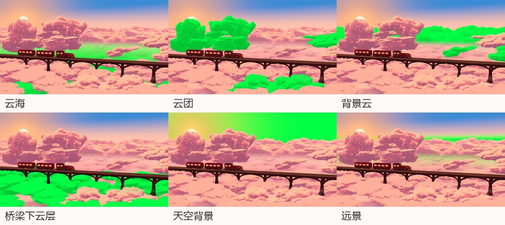
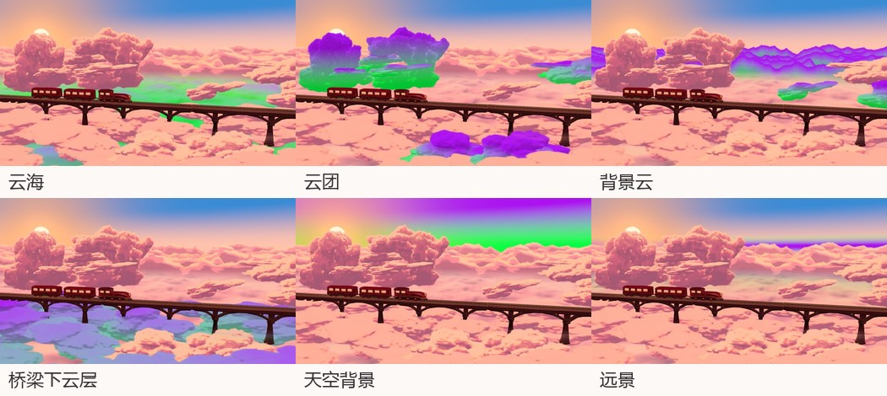

# 云间列车 v2.0 验收记录

2026-11-19，本地生产构建。基线为同一项目的 v1.0 提交 `de28422`。两版共用模型、纹理、浏览器和硬件。

## 使用入口

展开「场景控制 → 视觉预设 → 自定义配色」，选中一个区域，选择单色或双色渐变。点击起色或终色即可从色板选色、调用取色器或输入六位 HEX，再点「交换」可反转渐变。各套预设独立保存修改，刷新后恢复。「还原本区配色」只作用于当前行。

「旅行」显示当前状态和累计场景单位。车速大于零时列车沿直线持续前进。暂停保留里程，回到起点会清零并等待再次发车。列车和镜头使用局部坐标，固定数量的桥段、枕木和云团循环复用。

## 调色与兼容性

| 项目 | 验收方法和结果 |
|---|---|
| 色板和 HEX | 216 个 RGB 立方色加 40 个额外灰阶，共 256 个唯一色。浏览器内分别用键盘选中首、末色块，输入色板外色值并刷新，读回一致。 |
| 六区独立 | 固定镜头、车速为零、关闭风动，依次把每一区设为同一绿色。高低画质共 12 组均有可辨变化。列车和桥体延用原材质，远景调色覆盖地平线霞光与远雾。 |
| 双色渐变 | 各区分别设置绿、紫两端并交换顺序，12 组画面均随方向改变。将两端设为同色后，画面与单色模式一致。 |
| 还原、持久化与迁移 | 单区还原后与基准画面一致。浏览器实测两套预设分别保存、刷新和重置。单元测试覆盖 v4 设置迁移和损坏色值逐区回退。 |
| 原预设 | 1280 × 720 同机位比较。珊瑚晚霞、橘色暮光、紫夜航线分别有 99.23%、99.21%、99.25% 的像素在各 RGB 通道上的绝对差均 ≤5（满量程 255）。铁路向画面两端延伸。 |
| 窄屏编辑 | 390 × 844 窄屏实际展开面板、选择天空区域、点选色板并读取持久化值。 |

画面对照从实际 WebGL 画布取样，六区测试固定绘制分辨率，缩采样到 640 × 360 后比较。任一 RGB 通道差值大于 5 记为变化像素。同色端点对照与单区还原对照均为 0 个变化像素。[逐区像素统计](verification/v2/visual-checks.json) · [三套预设前后对照](verification/v2/presets-overview.jpg) · [窄屏编辑器](verification/v2/mobile-editor.jpg)

## 行驶与桥段接缝

- 三种设定车速分别模拟至少 10,000 次跨段，越过原线路终点后继续按设定速度前进。检查桥段复用前后每两个相邻桥段中心保持 25 单位间距，同时复核车厢间距、轮轨高度和暂停后的起步。
- 在远景、环绕、车外跟随和电影巡航四种镜头下分别取得跨段前后截图。环绕测试将镜头拉远，画面中可见车尾和连续桥轨。逐组对照可见桥墩与云团向后移动，桥面接续，列车位置连贯。[四机位截图](verification/v2/crossings-overview.jpg)
- 浏览器实测暂停、继续、零速和回到起点。用独立 Edge 的两个标签页验收后台恢复。切出时收到原生隐藏事件，里程为 2.4 单位。3 秒后切回，恢复可见的瞬间仍为 2.4，随后行驶到 8.5。另测历史导航返回，隐藏及恢复时均为 2.2，随后行驶到 8.1。[标签切换记录](verification/v2/tab-visibility.json) · [历史导航记录](verification/v2/history-visibility.json)

## 工程检查

7 个测试文件、32 项测试通过。`npm.cmd run build` 完成 TypeScript 检查和 Vite 生产构建。当前生产主包约 1.22 MB，gzip 约 346 kB，Vite 给出大于 500 kB 的分包提示。

## 运行条件

Edge 157.0.4341.60，Windows，Intel Core i9-14900HX，RTX 4060 Laptop GPU（D3D11）。帧率使用应用渲染提交时刻计算。高低档均保留动态 DPR。窄屏性能使用同一台电脑模拟 390 × 844 视口，按本轮要求跳过手机真机测试，真机 30 FPS 指标未测。

## 长跑与性能放行

按用户决定直接交付，30 分钟长跑和最终构建性能复测按放行处理。交付时最终构建已实测 21 分钟，最高车速 12，里程从 20.3 增至 15140.2 单位。各采样点均处于前台，里程持续增加。桥段为 49，材质为 125，纹理为 23，着色器程序为 9。提交前长跑已停止，最终记录为 25 分钟、18020.3 单位，全部已记录采样无报错。[最终构建长跑采样](verification/v2/cruise-30min.json)

以下是本轮开发期间已完成的性能采样。每档预热 6 秒，随后统计约 12 秒。v2 样本早于最终的云团循环过渡和旅行面板调整。

| 视口与画质 | v1.0 平均 FPS | v2 开发构建平均 FPS | v1.0 P95 帧间隔 | v2 开发构建 P95 帧间隔 |
|---|---:|---:|---:|---:|
| 1920 × 1080 高档 | 60.00 | 60.00 | 17.5 ms | 17.6 ms |
| 1920 × 1080 低档 | 60.01 | 60.01 | 17.2 ms | 17.4 ms |
| 390 × 844 窄屏低档（桌面模拟） | 60.01 | 60.00 | 17.3 ms | 17.4 ms |

[修改前原始数据](verification/v2/before.json) · [本轮开发构建原始数据](verification/v2/after.json)
